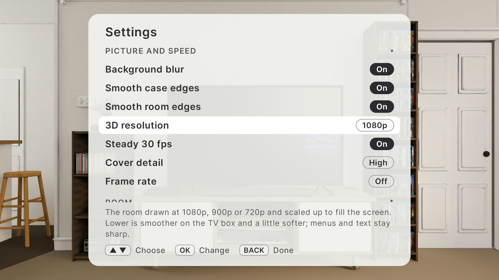
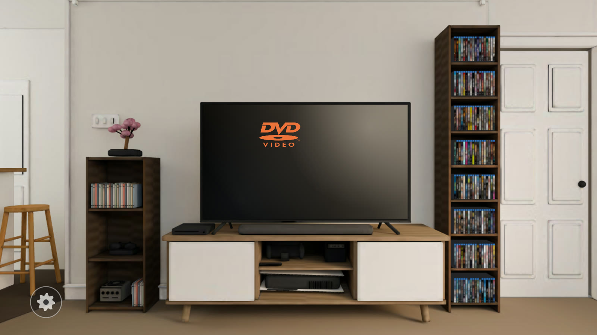
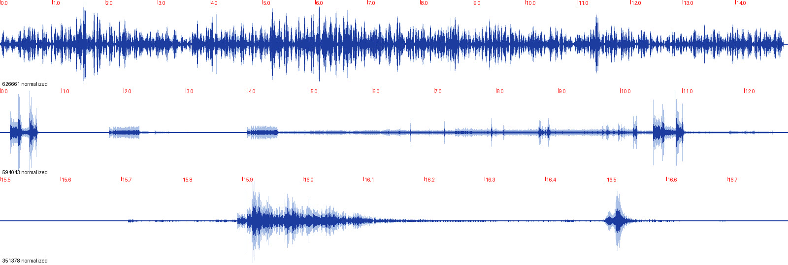
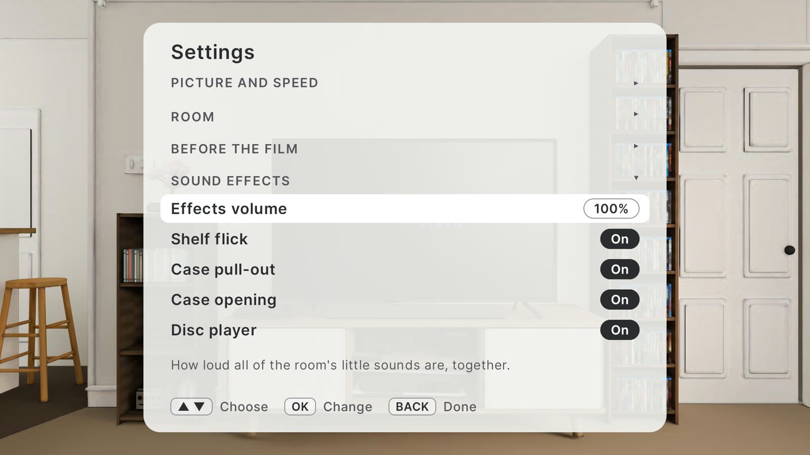

# Performance, sound and GitHub prep (Android TV, 1 November 2026)

All numbers were measured on the Onn 4K Pro (Mali-G31) with the app's `ShelfLifePerf` BENCH logging. Run-to-run noise is about ±2 fps.

## Summary

| Moment | Before | After |
|---|---|---|
| Case opens, disc lifts out | 12 fps | 27 fps at 1080p, 30 at 720p |
| Disc flies off to the right | 10.5 fps | 27 fps at 1080p, 30 at 720p |
| Down to the player | 25 fps | 27 fps at 1080p, 29.5 at 720p |
| Zoom room ↔ shelf | ~20 fps at 1080p | ~27 fps at 720p |

## 1. Cheaper shading for the disc and the open case

**Cause:** Filament's generic glTF shader ("ubershader") on the disc and the open case was too heavy for the Mali GPU once they filled the screen. The CPU was idle, at about 5 ms per frame.

**What changed:**
- The disc's silver and the case plastic use a small lit material: `work/materials/hand_solid.mat`.
- The label and rainbow layers are drawn unlit (`hand_layer.mat`), scaled to 55% brightness to match the old lit look. That figure was measured from screen recordings.
- `HandMaterials` in `RoomRenderer.kt` applies both. If the compiled `.filamat` files are missing, the generic shader stays.
- Custom materials have to flip the texture's V coordinate. The first build missed this and printed the label upside down.

This took the lift from 12 fps to about 24.

## 2. Pre-rendered disc insert, with the label live

The case opening, the disc lifting and tilting, and the fly-off are baked once on the TV box itself into compressed (ASTC 6x6) frames. Because the bake uses the same renderer, the clip matches the live picture exactly.

- **Two layers.**
  - The case: stored once while it stands still, 35 distinct frames.
  - The disc: baked with the case filling depth only, so whatever the lid hides is left out. 61 distinct frames.
  - Total: 17 MB, down from 31.5 MB as a single layer.
- **Live label.** The film's label and the covers on the lid are still drawn live, placed from `InsertTimeline` (`Insert.kt`) at the shown frame's own time. They stay put on the disc as it tilts and flies off.
- **The lid still hides the label.** The case plastic stays in the scene, filling depth only (`hand_depth.mat`) and drawn first.
- **Fallback.** A missing or outdated clip is logged, and the disc is drawn live instead.

**Re-bake after changing `InsertTimeline`, the case or disc look, or the lighting.** Steps are at the top of `work/make_insert_clip.py`:

```
adb shell am start -n com.shelflife.tv/.MainActivity --ez bakeInsert true   # ~3 min, then "insert baked" in logcat
adb pull /sdcard/Android/data/com.shelflife.tv/files/insert-bake <dir>
python3 work/make_insert_clip.py <dir>/insert-bake android/app/src/main/assets <astcenc>
```

## 3. 3D resolution setting

Settings → Picture and speed → **3D resolution**: 1080p, 900p or 720p. Only the room is drawn smaller; the display scales it up, so menus and text stay sharp. The DVD screensaver logo is placed in screen pixels, so it still sits on the TV. The default stays 1080p. 900p wasn't measured.





## 4. Smaller fixes

- The camera matrix array and the deck's animation list are reused each frame instead of rebuilt.
- **Checked and left alone:**
  - The DVD screensaver logo: zooms ran the same with it on or off.
  - The film player loading during the insert: no measurable cost.

## 5. Sound

### Timing

Each whoosh is now placed so its loudest moment lands in the middle of its camera move (`atMidMove` in `MainActivity.kt`). `SFX_DELAY_MS` moves them all later or earlier to suit a TV's sound delay.

| Sound | Change |
|---|---|
| Zoom in | Delayed 145 ms. Its peak is 230 ms into the clip, and the 0.75 s move peaks at 375 ms. |
| Zoom out | Cut 100 ms of near-silence from the start, then made 25% louder (peak −19 dB). |
| Case pull-out | Now plays with the case's 0.6 s flight, not the button press. Before, it could play seconds early while the cover downloaded. |
| Shelf flick | Cut 80 ms of quiet lead-in so it answers the press faster. |

The original files are in `work/sfx-backups/`.

### New: the DVD player during the insert

| Time | Sound |
|---|---|
| 3.55 s | Tray motor out |
| 5.27 s | Disc dropping onto the tray (timed to the moment it lands) |
| 5.35 s | Tray motor in |
| 5.95 s | Quiet spin-up that fades out |

`work/make_deck_sfx.py` cuts and levels these from the source recordings, kept in `work/sfx-sources/`.



### New settings

Settings → Sound effects:
- **Effects volume** (25 / 50 / 75 / 100%). It plays a flick at the new level so you can hear it.
- **Disc player** (on or off).



### Sources

All are CC0 (public domain): no attribution required. Licences were checked on Freesound on 1 November 2026.

| File | Freesound | Author |
|---|---|---|
| `shelf_flick.wav` | [422535](https://freesound.org/s/422535/) Menu_Flick_Sound | Killersmurf96 |
| `case_pullout.wav` | [667384](https://freesound.org/s/667384/) book pullout | MasterSuite |
| `case_open.wav` | [177827](https://freesound.org/s/177827/) DVD Case Opening & Closing | DeantheDinosauce |
| `zoom_in.wav` | [475135](https://freesound.org/s/475135/) FX - Swoosh - Low Pitch | bolkmar |
| `zoom_out.wav` | [449995](https://freesound.org/s/449995/) whoosh_med_low | DJT4NN3R |
| `tray_open.wav`, `tray_close.wav`, `disc_spin.wav` | [594043](https://freesound.org/s/594043/) DVD disc drive spinup/down | SamsterBirdies |
| `disc_drop.wav` | [351378](https://freesound.org/s/351378/) DVD player disc in tray | thaighaudio |

## Tried and removed: Google TV "Continue watching"

The app published the disc in the player to Android's Watch Next list, with its poster shared through a FileProvider. The entry was added correctly (confirmed in the app's log), but Google TV's Continue watching row only lists apps in Google's partner programme (Disney+ and Peacock, for example; not even Plex). The code and the tvprovider dependency were removed.

## 6. Preparing the repo for GitHub

### Kept out by `.gitignore`

- `android/secrets.env` (API keys and `EXTRAS_URL`) and `android/local.properties`.
- `outputs/`: the packaged Mac app.
- Logs, backups, build output and renders that the scripts regenerate.
- Downloaded reference footage and images.
- Trademarked source artwork: `work/warning-sources/` and the rendered intros.
- The macOS prototype (`Sources/`, `Package.swift` and its build and QA scripts in `work/`). It stays on disk but isn't published.

### Trademarked assets moved out of the APK

The 7 videos and 10 images left `res/`, and the APK dropped from 178 MB to 25 MB. They're now fetched by `Extras.kt`, and anything missing is skipped.

| Asset | Fetched from |
|---|---|
| FBI seal, Interpol emblem | Wikimedia Commons (until 2 November 2026; both cards are now replaced, see [warning-cards.md](warning-cards.md)) |
| DVD Video and Blu-ray logos | Wikimedia Commons, turned white |
| Six studio logos | TMDB company logos, converted to case-back ink. Sony uses Columbia's. |
| Seven videos | Your own server (`EXTRAS_URL`). They're renders with no public source. |

Setup is in [extras.md](extras.md). Update, 2 November 2026: the FBI and Interpol cards were replaced by ShelfLife's own anti-spoiler card, built into the app; see [warning-cards.md](warning-cards.md).

## Tools used

- **Materials:** compiled with Filament 1.77.3's `matc`: `matc -p mobile -a opengl -o android/app/src/main/assets/<name>.filamat work/materials/<name>.mat`
- **Clip encoding:** ASTC encoder 5.7 (`astcenc`) and Pillow.
- **Build:** `./gradlew assembleRelease` in `android/`, with JDK 21.
