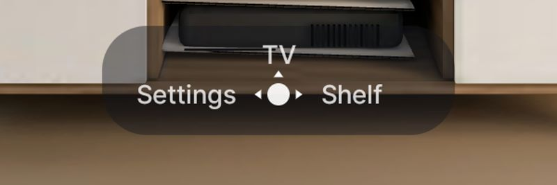
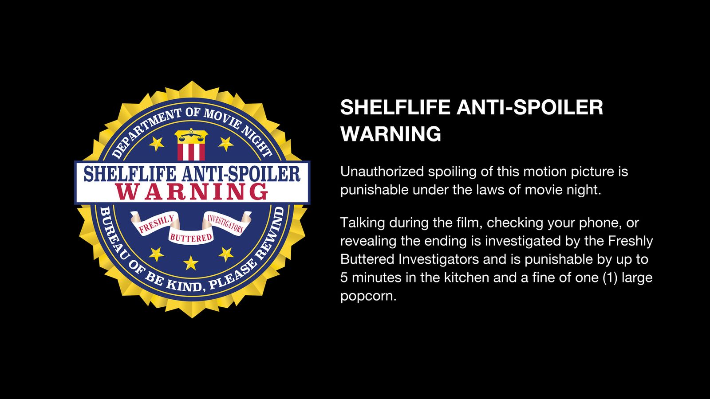
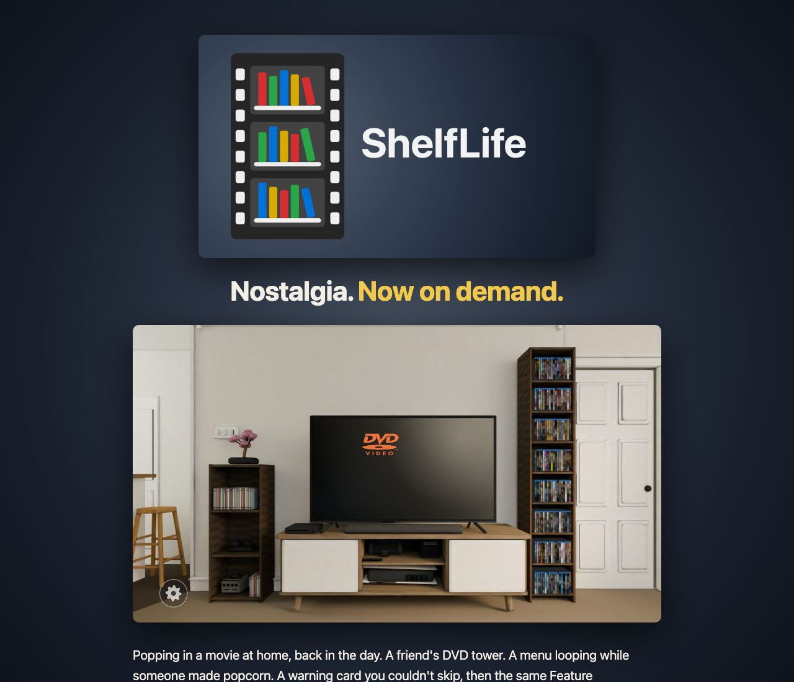

# Search, the warning card, the TV screensaver and the website (2 November 2026)

## Where things stand

| | State |
|---|---|
| Source code | On GitHub at [speelyberg/ShelfLife](https://github.com/speelyberg/ShelfLife), MIT licence. |
| Website | Live: [speelyberg.com](https://speelyberg.com) (homepage) and [speelyberg.com/shelflife](https://speelyberg.com/shelflife) (the project page). See [website.md](website.md). |
| Intro videos | Live at `speelyberg.com/shelflife/assets`, the default for every build. |

## 1. Search, above the top shelf

- **Opening it:** on the top shelf, ▲ raises the camera 10 cm (`SEARCH_LIFT` in `RoomRenderer.kt`) and a search bar appears just above the tower's top, as wide as the shelf rows. Its position comes from projecting the tower top's front edge (2.18 m up, z 0.325) every frame (`RoomRenderer.shelfTop`).
- **Typing:** OK opens the TV's keyboard into a hidden text field. Results update as you type. The keyboard's search key, ▼ or BACK closes the keyboard.
- **What it searches:** the whole Plex library, fetched once the first time search opens (without Plex, the shelf's sample films). Titles starting with the text come first ("The" ignored), then a word starting with it, then the text anywhere in the title.
- **Results:** DVD cases with the film's poster, five to a row, two rows at a time, scrolling by row. The grid is 1.55× the shelf's width (`GRID_SCALE` in `Search.kt`), centred and kept inside the TV-safe margins. The highlighted film's title shows at the right of the bar.
- **Blur:** the room blurs behind the results the same way it does behind a case in your hands (`RoomRenderer.searching`). It needs **Background blur** on, under Settings → Picture and speed.
- **Picking one:** OK puts the film in the highlighted top-shelf slot (`Shelf.replaceFocused`), printing its spine if the shelf didn't have it, and takes it out into your hands. Putting it back lowers the camera to the top shelf again.
- **Leaving:** BACK from the results returns to the bar; BACK from the bar closes search.

Code: `Search.kt` (the bar and the cases) and the search section of `MainActivity.kt`.

## 2. The nav pill

The D-pad drawing in the room's hint pill lost its ring, its ▼ arrow (nothing in the room uses it) and the "OK" text on the centre button. The pill is shorter to match: the arrows' box went from 40 to 30 dp, with less vertical padding (`DpadHints` and `KeyHints` in `Overlay.kt`).

## 3. The warning card

The FBI and Interpol cards are gone. In their place is one card of ShelfLife's own, a parody of the modern FBI anti-piracy warning: the Department of Movie Night seal, the Freshly Buttered Investigators ribbon, and an anti-spoiler warning. It's built into the APK (`res/drawable-nodpi/warning_card.png`) and shown full screen for 6.5 s, with the first 3 s unskippable.

- **How it's made:** procedurally, by `work/make_fbi_seal.py` (the seal, as layers usable in After Effects) and `work/make_fbi_card.py` (the 16:9 card). The real seal was used for measurements only.
- **Settings:** one row, **Warning card**. The Interpol row is gone.
- **The old cards:** described in full, with their code, in [warning-cards.md](warning-cards.md).

## 4. The TV screensaver

The bouncing DVD logo from the room's TV is now also a real Android screensaver, **ShelfLife DVD** (`DvdDream.kt`), installed with the app. It shares its bounce and colour changes with the room's TV (`Screensaver.kt` now takes the picture's corners as a function).

- **Effects:** Settings → **TV screensaver**: speed, logo size, glow, scanlines and a corner flash. Colour follows **DVD screensaver** under Room.
- **Choosing it on Google TV:** the Onn's settings only offer Google's Ambient mode, so it's one adb command. Details in [screensaver.md](screensaver.md).
- **Tested** on the emulator, then on the Onn that evening. The first glow (a live Android blur on the moving logo) left big smeared trails in old colours on the Onn's Mali GPU, so the glow is now a blurred copy of the logo made once on the CPU; that looks right on the Onn. The corner flash hasn't been seen, since corners are rare.

## 5. Hosting: speelyberg.com

The intros are on speelyberg.com: a domain on Cloudflare, an R2 bucket behind a Worker. The app's default `EXTRAS_URL` points there. They're kept on their own domain because they reproduce studio logos (20th Century Studios, Sony Pictures, Warner Home Video, Paramount's licence card).

## 6. The website

The same Worker serves the homepage ("speelyberg" in soft, glowing white pixel letters on black) and the ShelfLife page:
- the TV banner, drawn at 2× by `work/icon/make_brand.swift`;
- the tagline, "Nostalgia. Now on demand.";
- the living room;
- a section per feature, each with screenshots and short notes;
- the logo's radial gradient as the background.

How it's built, deployed and updated is in [website.md](website.md).

The two Feature Presentation bumper stills are from the second half of the Paramount- and Disney-style intros, picked because neither shows a logo.

## 7. Publishing prep

- **Ignored:** the QA image with the real FBI seal in it (`work/fbi-seal/fbi_check.png`), and the Warner render stills (`work/wbm_*.png`).
- **Added:** an MIT `LICENSE`. It covers the code and original artwork, not the downloaded marks.
- **Scanned for secrets:** the actual TMDB key (text and binary), common API key and token formats, private keys, Plex tokens and key-like files. None were found. `TokenStore.kt` matched only by name.
- **Identity:** commits are as `speelyberg <speelyberg@users.noreply.github.com>`.

## Hardware note

The Onn 4K Pro (1st generation) has a Mali-G31, a 2018 entry-level GPU, and it's what limits ShelfLife (zooms ~20–27 fps, the pre-rendered disc insert). Boxes with the Amlogic S905X5M have its successor, the Mali-G310, which Arm rates at up to 6× the G31's texturing; reviewers find them faster than the Google TV Streamer. Those boxes are the 2026 Onn 4K Pro, Onn 4K Plus and Xiaomi TV Stick 4K 2nd Gen. Not yet tested with ShelfLife.
